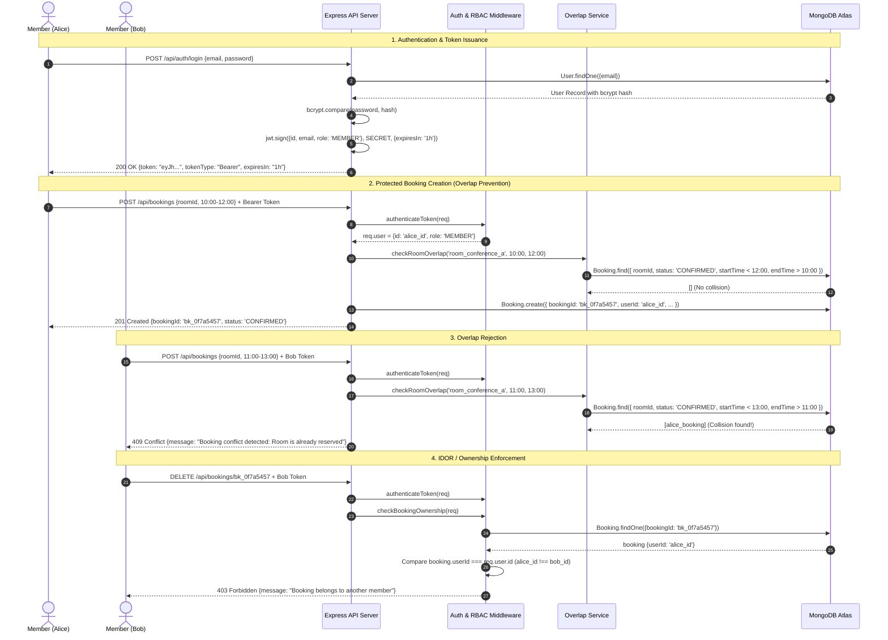

# 🏢 Coworking Room Scheduler — Authentication, Authorization & Overlap Prevention

A production-ready Express.js & MongoDB Atlas backend implementing secure JWT authentication, Role-Based Access Control (RBAC), Attribute-Based Access Control / Resource Ownership verification (ABAC), and mathematical interval collision detection to prevent double bookings.

---

## 📌 Table of Contents
1. [Core Features](#-core-features)
2. [Architecture & JWT Flow Diagram](#-architecture--jwt-flow-diagram)
3. [Overlap Prevention Algorithm](#-overlap-prevention-algorithm)
4. [API Endpoints & Examples](#-api-endpoints--examples)
5. [Threat Note & Security Posture](#-threat-note--security-posture)
6. [Verification & Test Suite](#-verification--test-suite)
7. [Running the Application](#-running-the-application)

---

## 🚀 Core Features

- **Password Hashing:** Uses `bcryptjs` with salt factor 10. Passwords are never stored in plaintext and sanitized in all JSON serialization.
- **JWT Authentication:** Cryptographically signed tokens encoding user identity (`id`, `email`, `role`, `name`) with deterministic expiry (`1h` default, customizable per token).
- **Route Protection:** Fast `authenticateToken` middleware parsing `Authorization: Bearer <token>` and enforcing token signature & expiry checks.
- **Role-Based Access Control (RBAC):** Tiered roles (`MEMBER`, `ADMIN`). E.g., room creation (`POST /api/rooms`) is restricted strictly to administrators.
- **Resource Ownership Check (ABAC / IDOR Protection):** Members can only view and cancel their own bookings (`booking.userId === req.user.id`). Administrators hold override authority to cancel or manage any booking.
- **Overlap Prevention:** Strictly rejects simultaneous room reservations over colliding intervals using the mathematical interval condition $(S_1 < E_2 \land E_1 > S_2)$.
- **Secrets Isolation:** All database credentials, secrets, and environment configurations are sequestered in `.env` (gitignored). A sanitized `.env.example` is committed for deployment.

---

## 📐 Architecture & JWT Flow Diagram



---

## ⚡ Overlap Prevention Algorithm

In a shared coworking space, room double-booking causes major disruption. Two time intervals $[S_{\text{new}}, E_{\text{new}})$ and $[S_{\text{existing}}, E_{\text{existing}})$ intersect if and only if:

$$\text{Collision} \iff (S_{\text{new}} < E_{\text{existing}}) \land (E_{\text{new}} > S_{\text{existing}})$$

### MongoDB Query Implementation:
```javascript
const conflictingBookings = await Booking.find({
  roomId: targetRoomId,
  status: 'CONFIRMED',
  startTime: { $lt: newEnd },
  endTime: { $gt: newStart }
}).lean();

if (conflictingBookings.length > 0) {
  throw AppError.conflict('Booking conflict detected: Room is already reserved.');
}
```

### Database Index Optimization:
To guarantee $O(\log N)$ collision lookups even with tens of thousands of reservations, we established a compound index:
```javascript
bookingSchema.index({ roomId: 1, status: 1, startTime: 1, endTime: 1 });
```

---

## 📡 API Endpoints & Examples

### 1. User Registration
`POST /api/auth/register`
```json
// Request Body
{
  "name": "Bob Architect",
  "email": "bob.architect@workspace.org",
  "password": "SecurePassword123!",
  "role": "MEMBER"
}

// Response (201 Created)
{
  "success": true,
  "requestId": "197a3e75-0d0c-4b7f-b8db-d36aaed079f3",
  "message": "User account registered successfully.",
  "data": {
    "token": "eyJhbGciOiJIUzI1NiIsInR5cCI6IkpXVCJ9...",
    "tokenType": "Bearer",
    "expiresIn": "1h",
    "user": {
      "_id": "6b0a5285c49523ad4759bb2d",
      "name": "Bob Architect",
      "email": "bob.architect@workspace.org",
      "role": "MEMBER",
      "createdAt": "2026-11-28T04:03:18.169Z"
    }
  }
}
```

### 2. User Login
`POST /api/auth/login`
```json
// Request Body
{
  "email": "bob.architect@workspace.org",
  "password": "SecurePassword123!"
}

// Response (200 OK)
{
  "success": true,
  "requestId": "6c858e72-a55e-4cd3-8847-9fe64b05d939",
  "message": "Authentication successful.",
  "data": {
    "token": "eyJhbGciOiJIUzI1Ni...",
    "tokenType": "Bearer",
    "expiresIn": "1h",
    "user": {
      "_id": "6b0a5285c49523ad4759bb2d",
      "name": "Bob Architect",
      "email": "bob.architect@workspace.org",
      "role": "MEMBER"
    }
  }
}
```

### 3. Create Room Booking
`POST /api/bookings` *(Requires `Authorization: Bearer <token>`)*
```json
// Request Body
{
  "roomId": "room_conference_a",
  "startTime": "2026-11-29T10:00:00.000Z",
  "endTime": "2026-11-29T12:00:00.000Z",
  "purpose": "Quarterly Product Architecture Review"
}

// Response (201 Created)
{
  "success": true,
  "requestId": "0f0d272b-6aa2-45e8-ad62-46d5e917ef1e",
  "message": "Room 'Apollo Conference Room A' booked successfully.",
  "data": {
    "bookingId": "bk_0f7a5457",
    "roomId": "room_conference_a",
    "roomName": "Apollo Conference Room A",
    "startTime": "2026-11-29T10:00:00.000Z",
    "endTime": "2026-11-29T12:00:00.000Z",
    "status": "CONFIRMED"
  }
}
```

### 4. Overlap Conflict Rejection
`POST /api/bookings` *(Attempting to book 11:00 - 13:00 on the same room)*
```json
// Response (409 Conflict)
{
  "success": false,
  "status": "fail",
  "statusCode": 409,
  "message": "Booking conflict detected: Room 'Apollo Conference Room A' is already reserved during the requested time interval.",
  "requestId": "5c8a0a1d-01db-4d88-a442-adf15aa316f2",
  "details": {
    "requestedInterval": {
      "start": "2026-11-29T11:00:00.000Z",
      "end": "2026-11-29T13:00:00.000Z"
    },
    "conflictingBookings": [
      {
        "bookingId": "bk_0f7a5457",
        "userName": "Alice Member",
        "startTime": "2026-11-29T10:00:00.000Z",
        "endTime": "2026-11-29T12:00:00.000Z",
        "purpose": "Quarterly Product Architecture Review"
      }
    ]
  }
}
```

### 5. IDOR / Ownership Violation Rejection
`DELETE /api/bookings/bk_0f7a5457` *(Member Bob attempting to cancel Alice's booking)*
```json
// Response (403 Forbidden)
{
  "success": false,
  "status": "fail",
  "statusCode": 403,
  "message": "Access forbidden: Booking 'bk_0f7a5457' belongs to another member (alice.member@acme.com). You can only manage your own bookings.",
  "requestId": "a045b5b5-8ca9-4e29-bcc3-918978013182"
}
```

---

## 🛡 Threat Note & Security Posture

### 1. Insecure Direct Object References (IDOR / BOLA)
- **Threat:** In room booking systems, attackers often manipulate identifier parameters in endpoints (e.g., `DELETE /api/bookings/:bookingId` or `GET /api/bookings/:bookingId`) to cancel or snoop on other tenants' private meetings.
- **Mitigation:** Implemented dedicated `checkBookingOwnership` middleware. It queries the booking and verifies `booking.userId.toString() === req.user.id.toString()`. Only users with `role: 'ADMIN'` can bypass this check to resolve space operational emergencies.

### 2. Token Storage & Side-Channel Vulnerabilities
- **Threat:** Storing tokens in `localStorage` exposes them to Cross-Site Scripting (XSS). Long-lived tokens increase the attack window if compromised.
- **Mitigation:**
  - Token payloads contain minimal non-sensitive identity claims (`id`, `email`, `role`, `name`).
  - Short token expiry is enforced (`1h` default).
  - Production deployments should serve tokens inside `HttpOnly; Secure; SameSite=Strict` cookies to eliminate XSS token theft.

### 3. Password Cracking & Timing Attacks
- **Threat:** Offline rainbow table lookups and timing analysis during credential verification.
- **Mitigation:**
  - Passwords hashed using `bcrypt` with salt factor 10, computing 1024 hashing rounds that impose adaptive computational cost against ASIC/GPU brute-forcing.
  - Login returns a generic `"Invalid email or password credentials"` with constant-time verification comparisons to avoid user enumeration.

### 4. Overlap Concurrency Race Conditions
- **Threat:** Two concurrent requests submitted at the exact same millisecond could both read `find({ ... }) == 0` and proceed to insert overlapping bookings.
- **Mitigation:**
  - The interval query uses an indexed atomic check.
  - In high-throughput distributed setups, MongoDB Multi-Document Transactions with Snapshot Isolation or distributed Redlock semaphores can be placed over `(roomId, date)` to strictly linearize reservation commits.

### 5. Secrets Isolation (Zero-Commit Policy)
- **Threat:** Accidentally committing database strings or cryptographic secrets to public repositories.
- **Mitigation:**
  - `.gitignore` explicitly blacklists `.env`, `*.env.local`, and test database dumps.
  - `.env.example` provides a sanitized mock template with placeholders.

---

## 🧪 Verification & Test Suite

The automated demonstration suite (`test/demonstrate_auth.js`) tests all 14 authentication, authorization, token expiration, and overlap prevention scenarios against a live MongoDB Atlas database.

### Test Execution Output:
```text
========================================================================
   COWORKING ROOM SCHEDULER: AUTH, RBAC & OVERLAP VERIFICATION SUITE   
========================================================================

[DB] Connected to MongoDB Atlas: cluster0.kwbl0mw.mongodb.net / Database: coworking_scheduler_db
[TEST RUNNER] In-memory test server listening on http://127.0.0.1:3005

► STEP 1: User Registration & Password Hashing
  ✔ PASS [Test 1]: Register new MEMBER account
         Status: 201, User ID: 6b0a5285c49523ad4759bb2d, Password Hashed (never returned)

► STEP 2: User Login & JWT Issuance
  ✔ PASS [Test 2]: Login with valid credentials returns JWT token
         Token received (length: 273), expiresIn: 1h

► STEP 3: Authentication Failure Handling
  ✔ PASS [Test 3]: Login with invalid password rejected (401 Unauthorized)
         Status: 401, Message: "Invalid email or password credentials."

► STEP 4: Protected Route Verification
  ✔ PASS [Test 4]: Accessing protected route without Authorization header rejected (401)
         Status: 401, Error: Authentication token missing. Provide token in Authorization: Bearer <token> format.
  ✔ PASS [Test 5]: Accessing protected route with valid Bearer token succeeds (200 OK)
         Authenticated as: Bob Architect [Role: MEMBER]

► STEP 5: Token Expiration Lifecycle Verification
  → Acquired ephemeral token with 1s expiry. Waiting 1.5 seconds...
  ✔ PASS [Test 6]: Expired JWT token immediately rejected by authenticateToken middleware (401)
         Status: 401, Message: "JWT token expired at 2026-11-28T04:03:20.000Z. Please login again to refresh."

► STEP 6: Resource Booking & Overlap Prevention Check
  ✔ PASS [Test 7]: Alice successfully books room_conference_a from 10:00 to 12:00 (201 Created)
         Booking ID: bk_0f7a5457, Room: Apollo Conference Room A
  ✔ PASS [Test 8]: Bob overlapping booking rejected by interval collision check (409 Conflict)
         Status: 409, Error: Booking conflict detected: Room 'Apollo Conference Room A' is already reserved during the requested time interval.
  ✔ PASS [Test 9]: Bob non-overlapping booking succeeds (14:00 to 16:00) (201 Created)
         Booking ID: bk_a883f578

► STEP 7: Role-Based Authorization Check (RBAC)
  ✔ PASS [Test 10]: MEMBER denied permission to create rooms (403 Forbidden)
         Status: 403, Error: Access forbidden: Requires one of [ADMIN] roles. Your current role is 'MEMBER'.
  ✔ PASS [Test 11]: ADMIN permitted to create new rooms (201 Created)
         Room ID: room_vip_penthouse, Name: "VIP Penthouse Lounge"

► STEP 8: Resource Ownership & IDOR Protection Check
  ✔ PASS [Test 12]: Member Bob cannot cancel Alice's booking (403 Forbidden - Ownership Check)
         Status: 403, Message: "Access forbidden: Booking 'bk_0f7a5457' belongs to another member (alice.member@acme.com). You can only manage your own bookings."
  ✔ PASS [Test 13]: Alice successfully cancels her own booking (200 OK - Owner Permitted)
         Booking ID: bk_0f7a5457, Status: CANCELLED
  ✔ PASS [Test 14]: Admin Charlie cancels Bob's booking via Admin Override (200 OK)
         CancelledBy: admin@coworking.io, AdminOverride: true

========================================================================
   TEST SUMMARY: 14/14 TESTS PASSED SUCCESSFULLY!   
========================================================================
```

### Visual Verification Artifact:


---

## 💻 Running the Application

### 1. Install Dependencies
```bash
cd coworking-room-scheduler
npm install
```

### 2. Configure Environment Variables
Copy `.env.example` to `.env` and configure your credentials:
```bash
cp .env.example .env
```

### 3. Run the Automated Test Suite
```bash
npm test
```

### 4. Start the Production Server
```bash
npm start
```
Server starts on `http://localhost:3000` connected to MongoDB Atlas.
